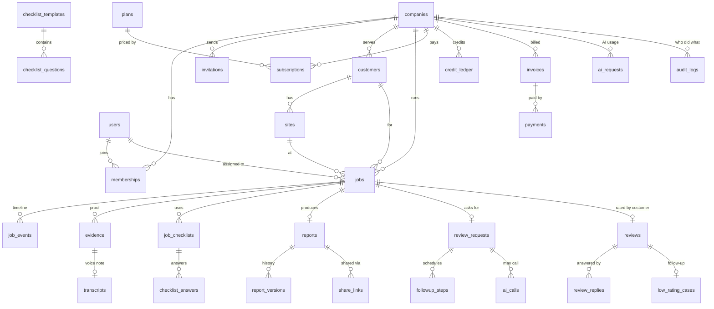

# KaamNishaan — database design (draft for review)

PostgreSQL 16 · SQLAlchemy 2 · Alembic. Status: **draft, Step 0** — nothing is migrated until this is approved.

## Ground rules

1. **Every company-owned row has `company_id`.** All queries go through a repository layer that always filters by the caller's company. Postgres row-level security can be added later as a second guard.
2. **UUID primary keys** everywhere (`id uuid`), plus `created_at` / `updated_at` (`timestamptz`). Human numbers (`J-2231`, `R-1042`, `INV-3108`) come from a per-company counter, never from the id.
3. **Evidence is tamper-proof once a report is submitted.** `evidence.locked_at` is set on submit; a database trigger rejects `UPDATE`/`DELETE` on locked rows. Fixes go in as new evidence or a note, never an edit.
4. **No report reaches a customer without human approval.** A share link can only be created for a report in status `approved`. This is checked in the API *and* by a constraint on `share_links`.
5. **Offline-safe writes.** Every create the app can make offline (`evidence`, `checklist_answers`, `jobs` quick jobs, `review_requests`) carries a device-generated `client_id` with a unique index — retries never create duplicates.
6. **Translatable text** that users author once and many read in other languages (checklist prompts, plan names, industry names, website blocks) is stored as `jsonb` like `{"en": "...", "hi": "...", "gu": "..."}`.
7. **Money** is stored as integer minor units (`amount_minor`, paise or cents) plus a `currency` code. Never floats.
8. **Credits are a ledger**, not a counter: the balance is the sum of `credit_ledger.delta`, with `balance_after` cached on each row.
9. **Soft delete** only where the product needs undo or history (`customers`, `sites`, `checklist_templates`): `archived_at`. Evidence, reports, reviews and audit logs are never deleted by users.
10. **Secrets and files are not in the database.** Photos, voice notes, PDFs and recordings live in Cloudflare R2; the database stores the object key only.

## Entity map

## Tables

### Identity and tenancy

| Table | Key columns | Notes |
|---|---|---|
| `users` | `phone` (E.164, unique, nullable), `email` (unique, nullable), `password_hash` (nullable), `name`, `avatar_key`, `app_language` (`en`/`hi`/`gu`/`es`/`fr`), `status` (`invited`, `active`, `disabled`), `is_super_admin`, `last_seen_at` | Technicians sign in by phone OTP (no password). Managers/owners by email + password, or phone. At least one of phone/email is required (check constraint). |
| `companies` | `name`, `industry_id`, `country` (default `IN`), `timezone` (default `Asia/Kolkata`), `report_language`, `logo_key`, `status` (`trial`, `active`, `past_due`, `suspended`, `cancelled`), `trial_ends_at`, `settings` jsonb | `settings`: `technicians_can_share`, `technicians_can_request_reviews`, review follow-up schedule, calling hours. |
| `memberships` | `company_id`, `user_id`, `role` (`owner`, `manager`, `technician`), `status` (`invited`, `active`, `removed`), `invited_by`, `joined_at` | Unique `(company_id, user_id)`. One company per user in the MVP; the table allows more later. |
| `invitations` | `company_id`, `phone`, `name`, `role`, `token_hash`, `expires_at`, `accepted_at`, `invited_by` | M40 invite → SMS link → M10 join. |
| `otp_challenges` | `phone`, `code_hash`, `purpose` (`login`, `verify_phone`), `attempts`, `expires_at`, `consumed_at`, `ip` | 4-digit code, 5-minute expiry, max 5 attempts, rate-limited per phone and IP. |
| `sessions` | `user_id`, `refresh_token_hash`, `device_id`, `platform`, `app_version`, `expires_at`, `revoked_at` | Short-lived JWT access token + rotating refresh token. Logout and "log out everywhere" revoke rows. |
| `devices` | `user_id`, `push_token`, `platform`, `locale`, `last_seen_at` | Push notifications. |
| `company_counters` | `company_id`, `key` (`job`, `report`, `invoice`), `value` | Gives `J-2231`, `R-1042` with `SELECT … FOR UPDATE`. |

### Customers and sites

| Table | Key columns | Notes |
|---|---|---|
| `customers` | `company_id`, `name`, `contact_name`, `phone`, `email`, `preferred_language`, `notes`, `archived_at` | Customers never log in. |
| `sites` | `company_id`, `customer_id`, `name`, `address_line`, `city`, `state`, `postal_code`, `country`, `lat`, `lng`, `archived_at` | One customer can have several sites (clinic branches). |
| `contact_opt_outs` | `company_id`, `phone` or `email`, `scope` (`reviews`, `all`), `source` (`sms_stop`, `whatsapp`, `email_link`, `ai_call`, `manager`), `created_at` | Checked before every message or call. Never removed automatically. |

### Checklists

| Table | Key columns | Notes |
|---|---|---|
| `checklist_templates` | `company_id` (null = global template), `industry_id`, `name` jsonb, `version`, `status` (`draft`, `published`, `archived`) | Editing a published template creates a new version; jobs keep the version they started with. |
| `checklist_questions` | `template_id`, `position`, `type` (`yes_no`, `pass_fail`, `number`, `photo`, `signature`, `text`), `prompt` jsonb, `unit`, `photo_rule` (`never`, `always`, `on_no`, `on_fail`), `reference_photo_key` | M25 "look for this" reference photo. |
| `job_checklists` | `company_id`, `job_id`, `template_id`, `template_version`, `completed_at` | |
| `checklist_answers` | `company_id`, `job_checklist_id`, `question_id`, `value` jsonb, `evidence_id` (nullable), `answered_by`, `answered_at`, `client_id` (unique) | Locked with the evidence on submit. |

### Jobs and evidence

| Table | Key columns | Notes |
|---|---|---|
| `jobs` | `company_id`, `number`, `customer_id`, `site_id`, `title`, `description`, `scheduled_at`, `status`, `assigned_to`, `created_by`, `is_quick_job`, `report_language`, `started_at`, `completed_at`, `cancelled_at`, `cancel_reason`, `client_id` | Status machine below. |
| `job_events` | `company_id`, `job_id`, `type` (`created`, `assigned`, `accepted`, `started`, `evidence_added`, `report_submitted`, `changes_requested`, `approved`, `shared`, `cancelled`), `from_status`, `to_status`, `actor_id`, `data` jsonb, `at` | Powers A12 / M15 timelines; never updated. |
| `evidence` | `company_id`, `job_id`, `kind` (`photo`, `voice`, `signature`), `stage` (`before`, `during`, `after`), `storage_key`, `mime`, `bytes`, `width`, `height`, `duration_ms`, `sha256`, `captured_at` (device clock), `uploaded_at`, `captured_by`, `lat`, `lng`, `gps_accuracy_m`, `note`, `status` (`pending_upload`, `uploaded`, `processed`, `rejected`), `quality_flags` jsonb, `locked_at`, `client_id` (unique) | `sha256` proves the file was not changed. Trigger blocks edits after `locked_at`. |
| `transcripts` | `company_id`, `evidence_id` (unique), `language_detected`, `text_original`, `text_report_language`, `status`, `model`, `edited_by`, `edited_at` | The original recording is always kept (M29). |

**Job status machine** (from the PRD): `draft → assigned → accepted → in_progress → ai_draft → pending_review → completed`. `changes_requested` sends the job back to `in_progress`. `cancelled` is allowed any time before `completed`. Transitions are enforced in one service function and recorded in `job_events`.

### Reports and sharing

| Table | Key columns | Notes |
|---|---|---|
| `reports` | `company_id`, `job_id` (unique), `number`, `status` (`generating`, `draft`, `pending_review`, `changes_requested`, `approved`, `failed`), `language`, `content` jsonb (summary, work_done, advice, checklist summary), `ai_checks` jsonb, `prompt_version`, `submitted_by`, `submitted_at`, `reviewed_by`, `reviewed_at`, `change_request` jsonb, `pdf_key`, `version` | One report per job; edits create `report_versions`. |
| `report_versions` | `report_id`, `version`, `content` jsonb, `source` (`ai`, `technician`, `manager`), `created_by` | Full history; the PDF is built from the approved version. |
| `report_evidence` | `report_id`, `evidence_id`, `position` | Which photos appear in the report and in what order. |
| `share_links` | `company_id`, `report_id`, `token_hash`, `channel` (`whatsapp`, `sms`, `email`, `copy`), `recipient`, `expires_at` (default 30 days), `revoked_at`, `created_by`, `first_opened_at`, `open_count` | Only the hash of the token is stored. Expired → W29 "link expired" state. |

### Reviews and follow-ups

| Table | Key columns | Notes |
|---|---|---|
| `review_requests` | `company_id`, `job_id` (**unique** — one chain per job), `report_id`, `customer_id`, `requested_by`, `status` (`queued_until_approval`, `active`, `completed`, `opted_out`, `cancelled`, `paused_no_credits`), `current_step`, `next_step_at`, `client_id` | Creating one when a review already exists, the customer opted out, or a chain is active returns `409` — that is what hides the "Ask for review" button. |
| `followup_steps` | `company_id`, `request_id`, `step` (`day0_link`, `day2_reminder`, `day5_ai_call`, `missed_call_sms`, `thank_you_sms`), `channel` (`whatsapp`, `sms`, `email`, `voice`), `scheduled_at`, `sent_at`, `status` (`scheduled`, `sent`, `delivered`, `failed`, `skipped`, `cancelled`), `provider`, `provider_ref`, `failure_reason`, `credits_used` | All pending steps are cancelled in one transaction when any review arrives or the customer opts out. |
| `reviews` | `company_id`, `job_id` (**unique**), `request_id`, `customer_id`, `technician_id`, `service_rating` (1–5), `technician_rating` (1–5, nullable), `tags` text[], `comment`, `source` (`form`, `email_star`, `sms_reply`, `whatsapp`, `ai_call`), `language`, `allow_public`, `callback_requested`, `status` (`published`, `hidden`, `flagged`), `flag_reason`, `submitted_at`, `editable_until` | `is_low` = `service_rating <= 2` (generated column) drives alerts. Companies can hide, never edit or delete. |
| `review_replies` | `company_id`, `review_id`, `author_id`, `body` | Shown on the customer page and to the technician. |
| `low_rating_cases` | `company_id`, `review_id` (unique), `status` (`open`, `resolved`), `assigned_to`, `note`, `resolved_by`, `resolved_at` | M45 follow-up screen. |
| `ai_calls` | `company_id`, `request_id`, `provider`, `provider_call_id`, `to_phone`, `language`, `started_at`, `ended_at`, `duration_s`, `outcome` (`rated`, `callback_requested`, `voicemail`, `no_answer`, `opted_out`, `wrong_person`, `provider_error`, `skipped_dnd`), `disclosure_played`, `recording_consent`, `recording_key`, `transcript` jsonb, `cost_minor`, `credits_used` | Disclosure must be `true` for every connected call. Max one call per request (unique partial index). |

### Plans, billing and credits

| Table | Key columns | Notes |
|---|---|---|
| `plans` | `code` (`free`, `starter`, `professional`, `business`, `enterprise`), `name` jsonb, `prices` jsonb (`{"INR": 74900, "USD": 900}` per month), `technician_limit`, `report_limit_monthly` (null = fair use), `monthly_credits`, `features` jsonb, `is_public`, `sort` | Website pricing, M41 and A17 all read this table. |
| `subscriptions` | `company_id`, `plan_id`, `status` (`trialing`, `active`, `past_due`, `cancelled`), `provider` (`razorpay`, `stripe`, `manual`), `provider_ref`, `current_period_start`, `current_period_end`, `cancel_at` | |
| `credit_packs` | `credits`, `prices` jsonb, `active` | 500 / 2,000 packs. |
| `credit_ledger` | `company_id`, `delta`, `reason` (`monthly_grant`, `top_up`, `sms`, `whatsapp`, `ai_call`, `refund`, `adjustment`, `expiry`), `ref_type`, `ref_id`, `balance_after`, `actor_id` | Spending checks balance in the same transaction (`SELECT … FOR UPDATE` on the company). |
| `invoices` | `company_id`, `number`, `amount_minor`, `currency`, `tax_minor` (GST), `status` (`draft`, `issued`, `paid`, `failed`, `refunded`), `provider_ref`, `issued_at`, `paid_at`, `pdf_key` | GST fields added when billing goes live. |
| `payments` | `company_id`, `invoice_id`, `provider`, `provider_ref`, `method` (`upi`, `card`, `netbanking`), `status`, `failure_reason`, `amount_minor` | Card numbers are never stored — only provider references. |
| `usage_monthly` | `company_id`, `period` (YYYY-MM), `reports_count`, `ai_questions_count`, `storage_bytes` | Plan-limit checks (M41 limit screens). |

### AI

| Table | Key columns | Notes |
|---|---|---|
| `ai_prompts` | `key` (`report_draft`, `transcript_clean`, `checklist_check`, `photo_quality`, `assistant_chat`, `review_call`), `version`, `status` (`draft`, `live`, `archived`), `system_prompt`, `variables` jsonb, `model`, `created_by` | A21. Exactly one `live` per key (partial unique index). |
| `ai_requests` | `company_id`, `kind`, `prompt_id`, `model`, `tokens_in`, `tokens_out`, `cost_minor`, `latency_ms`, `status`, `error`, `ref_type`, `ref_id` | A20 AI usage & cost. Personal data is masked before sending. |
| `assistant_messages` (v1.1) | `company_id`, `user_id`, `conversation_id`, `role`, `content`, `sources` jsonb | Answers only from the company's own jobs. |

### Content (everything the website and apps display comes from here)

| Table | Key columns | Notes |
|---|---|---|
| `industries` | `slug`, `name` jsonb, `status`, `default_template_id`, `page_slug` | A22, website industry pages. |
| `content_pages` | `slug` (`home`, `pricing`, `features/ai-reports`, …), `status`, `published_version_id` | A24. |
| `content_versions` | `page_id`, `locale`, `blocks` jsonb, `seo` jsonb, `created_by`, `published_at` | Draft/publish with history. |
| `blog_posts` | `slug`, `locale`, `title`, `excerpt`, `body`, `cover_key`, `author_name`, `status`, `published_at` | A26. |
| `testimonials` | `quote` jsonb, `person_name`, `role`, `company_name`, `avatar_key`, `approved_in_writing`, `status` | Shown only if `approved_in_writing` (A27). |
| `ui_strings` | `key`, `locale`, `value`, `status` (`ok`, `needs_review`, `missing`), `updated_by` | A25. Apps ship with bundled strings and pull overrides from the API. |
| `message_templates` | `key` (`day0_link`, `day2_reminder`, …), `channel`, `locale`, `body`, `variables`, `status`, `provider_template_id` (DLT template id / WhatsApp template name) | A39. India DLT requires the approved template id on every SMS. |
| `demo_requests` | `name`, `company`, `phone`, `email`, `team_size`, `industry`, `message`, `status` | Website "Book a demo". |

### Platform operations

| Table | Key columns | Notes |
|---|---|---|
| `notifications` | `user_id`, `company_id`, `type`, `title` jsonb, `body` jsonb, `data` jsonb, `read_at` | M42, A29 rules. |
| `support_tickets` / `ticket_messages` | `company_id`, `number`, `subject`, `status`, `priority`, `job_id` / `ticket_id`, `author_id`, `body` | A28. |
| `audit_logs` | `company_id` (nullable), `actor_id`, `actor_role`, `action`, `target_type`, `target_id`, `data` jsonb, `ip`, `user_agent`, `created_at` | Append-only (A31). Written for every admin action, approval, share, role change and "view as company". |
| `platform_settings` | `key`, `value` jsonb, `updated_by` | A19, A32–A35 settings. |
| `feature_flags` | `key`, `default` jsonb, `plan_overrides` jsonb, `company_overrides` jsonb | Per-plan / per-company switches. |

## Indexes that matter for speed

- `jobs (company_id, assigned_to, scheduled_at)` — technician Today screen.
- `jobs (company_id, status, scheduled_at)` — manager job list and dashboard tiles.
- `reports (company_id, status, submitted_at)` — review queue.
- `evidence (job_id, stage, captured_at)` — capture hub and gallery.
- `followup_steps (status, scheduled_at)` — the scheduler picks due steps.
- `reviews (company_id, submitted_at desc)`, `reviews (company_id) where is_low` — reviews list and alerts.
- `credit_ledger (company_id, created_at desc)`.
- Unique: `users.phone`, `users.email`, `*.client_id`, `review_requests.job_id`, `reviews.job_id`, `share_links.token_hash`.

## Data retention (India-first defaults, all configurable in A34)

- Photos, voice notes, reports: kept for 7 years (warranty and disputes).
- AI call recordings: 1 year, then transcript only.
- OTP challenges: deleted after 24 hours. Sessions: 90 days after expiry.
- Account deletion request: personal fields anonymised within 30 days; job proof kept for the company (DPDP-compliant notice in the privacy policy).

## Open questions for you

1. **One company per user** in the MVP (a technician can't work for two companies at once). OK?
2. **Prices in both INR and USD** in `plans.prices`, so the website can show ₹ for India and $ elsewhere. OK, and what INR prices?
3. **7-year evidence retention** by default. OK for India pilots?
